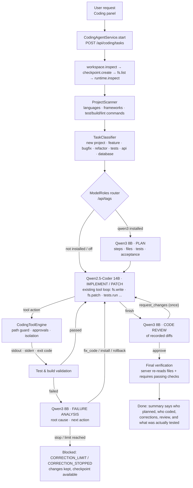

# Multi-Model Coding Agent (Qwen3 8B + Qwen2.5-Coder 14B)

The Chanakya coding agent now uses two local Ollama models:

| Role | Default model | Does | Never does |
|---|---|---|---|
| **Planner / reasoner** | `qwen3:8b` | Requirements analysis, implementation plan, task decomposition, failure analysis, code review | Call tools, write files, run commands |
| **Coder** | `qwen2.5-coder:14b` | Code generation, multi-file edits, patches, bug fixes, refactoring, tests | Decide it is "done": the server verifies |

Both are discovered live from Ollama (`/api/tags` + `/api/show`). Nothing is assumed to be installed: if
Qwen3 is missing, the agent runs single-model with rule-based failure analysis and says so in the task.

This is built **inside the existing coding agent**: same Express routes (`/api/coding/*`), same
`CodingAgentService` loop, tool engine, workspace guard, approvals, checkpoints, execution policy,
task history (SQLite) and Coding panel. No second app or duplicate services.

## Architecture



### Where each requirement lives

| Requirement | File |
|---|---|
| Model router (installed models only) | `backend/src/coding/ModelRoles.js` |
| Project scanner | `backend/src/coding/ProjectScanner.js` |
| Task classifier | `backend/src/coding/TaskClassifier.js` |
| Qwen3 planner / failure analyst / reviewer | `backend/src/coding/ReasoningAgent.js` |
| Pipeline (stages, correction loop, review, final summary) | `backend/src/coding/MultiModelPipeline.js` |
| Integration into the existing loop | `backend/src/coding/CodingAgentService.js` (hooks: `prepare`, `observe`, `review`, `finalize`) |
| Resource monitor API | `GET /api/coding/resources`, `POST /api/coding/resources/free` (`routes/coding.js`) |
| Limiter panel (click the context ring in the composer) | `frontend/src/coding/LimiterPanel.jsx`, `CodingComposer.jsx` |
| Pipeline view per task | `PipelineView` in `frontend/src/coding/CodingWorkspace.jsx` |
| Config | `backend/src/config.js` |

Existing pieces reused as-is: patch/diff generation (`WorkspaceFiles`), checkpoints + rollback
(`checkpoint.create/restore`), Git status/diff, test runner and validation records, approvals for
commands, downloads and destructive file operations, React/Vite scaffolding, language toolchains
(Node, Python, .NET/ASP.NET, Java, SQL/SQLite/PostgreSQL, Go, Rust, C/C++).

## Reliability rules (enforced by code)

- **No success without execution.** Only `verify()` marks a task done, and only from server-observed file
  versions and validation records with real exit codes. The summary says "Not tested" when no test/build ran.
- **stdout, stderr and exit codes** are captured for every `exec.run` / `tests.run` and sent (tail-bounded)
  to Qwen3 for analysis.
- **Bounded correction loop**: default 3 (1–6, set in the limiter panel or `CODING_MAX_CORRECTIONS`).
  Exceeding it ends the task as `CORRECTION_LIMIT`. Identical failing commands with no file change are
  stopped even earlier by the existing repeat guard.
- **Qwen3 decides the next action** (`fix_code`, `install_dependency`, `rerun`, `rollback`, `stop`); the
  coder carries it out through the normal tools. `stop` ends the task honestly (e.g. missing runtime).
- **Checkpoints** are created before the first change; rollback goes through `checkpoint.restore`, which
  needs approval.
- **Approvals** for commands, package downloads, deletes and restores are unchanged.
- **Reasoner output is advisory and untrusted**: schema-validated, length-bounded, paths outside the project
  are dropped, and it can never execute anything itself. Reasoner errors/timeouts degrade to single-model
  instead of failing the task.

## Install & configure (Windows)

1. Pull the reasoning model (the coder is already installed):

   ```powershell
   ollama pull qwen3:8b
   ollama list            # should show qwen3:8b and qwen2.5-coder:14b
   ```

2. Optional settings in `backend/.env` (defaults shown):

   ```ini
   CODING_MODEL=qwen2.5-coder:14b
   CODING_REASONER_MODEL=qwen3:8b       # or 'off' to disable the planner
   CODING_MAX_CORRECTIONS=3             # 1-6
   CODING_MODEL_SWAP=auto               # auto | keep
   CODING_REASONER_TIMEOUT_SECONDS=300
   CODING_REASONER_THINK=0              # 1 = Qwen3 thinking mode (slower, deeper analysis)
   ```

   `CODING_MODEL_SWAP=auto`: on GPUs under 12 GB (your RTX 3050 6 GB) the coder is unloaded before Qwen3
   runs, and Qwen3 leaves memory 30 s after answering, so each model gets the GPU to itself instead of both
   spilling to CPU. Use `keep` on a big GPU.

3. Restart the app (`npm run dev` or the desktop build). In the Coding panel, click the **context ring**
   (bottom-right of the composer) to open the limiter panel: Planner = Auto (qwen3:8b), Coder = your model,
   max fix attempts, live VRAM/RAM/CPU, loaded models with GPU %, and **Free GPU memory**.

## Tests

Unit + integration tests (fake models, real agent loop, SQLite, approvals):

```powershell
node --test backend/src/coding/ModelRoles.test.js backend/src/coding/ProjectScanner.test.js backend/src/coding/ReasoningAgent.test.js backend/src/coding/MultiModelPipeline.test.js
npm test        # whole suite
```

Live smoke test against your real Ollama models (writes nothing, runs nothing):

```powershell
node backend/scripts/multimodel-smoke.mjs
```

It prints the resolved roles, a real Qwen3 plan, a real failure analysis and a real code review.

## API additions

- `GET /api/coding/models` → adds `roles` (`mode`, `coder`, `reasoner`, `candidates`, `reasons`),
  `defaultReasonerModel`, `maxCorrections`.
- `POST /api/coding/tasks` → optional `reasonerModel` (`auto` | `off` | installed tag) and
  `maxCorrections` (1–6). Task JSON gains `pipeline` (stages, plan, analyses, reviews, notes, metrics).
- `GET /api/coding/resources` → memory, CPU %, GPU, loaded models (`gpuPercent`), inference queue,
  limits, the caller's active tasks.
- `POST /api/coding/resources/free` → unloads all Ollama models; refused (409) while a task runs.
